# Black Cat Nails · App móvil

Aplicación móvil en **React Native (Expo)** para el emprendimiento de manicura **Black Cat Nails by Vante**. Es la versión para clientas del sistema multiplataforma desarrollado en **DPS941 (Diseño y Programación de Software Multiplataforma)** de la **Universidad Don Bosco**. La versión web administrativa vive en [Kikeagv/Black-cat-nails-web](https://github.com/Kikeagv/Black-cat-nails-web).

> Entrega: **Etapa 3 · Avance 1 · Foro de Discusión 1** (Diseño UX/UI + React Native).

## Integrante

| Nombre | Carné | Rama |
| --- | --- | --- |
| Enrique Alejandro García Villeda | GV200136 | `enrique-garcia` |

## Problema que resuelve

La propietaria dedica entre 10 y 14 horas semanales a coordinar citas por mensajería, tiene entre 12 % y 19 % de inasistencias y ya sufrió citas encimadas. La app traslada el agendamiento a la clienta: consulta el catálogo y la galería, ve solo los horarios donde cabe el servicio que eligió, confirma su asistencia y recibe el aviso de retoque cuando le toca volver.

## Diseño

- Prototipo en Figma: [Black Cat Nails · Mobile](https://www.figma.com/design/HuzR5fGLVFFeSiOJksZZls/CN?node-id=92-2)
- Los tokens de Figma (`Dark #191308`, `Berry Crush #B5446E`, `Petal Pink #E477C1`, `Wisteria Blue #9CA3DB`) están en [`src/theme/tokens.ts`](src/theme/tokens.ts). Tipografías: Playfair Display (títulos) e Inter (texto).

| Login | Error | Inicio | Galería | Detalle |
| --- | --- | --- | --- | --- |
| 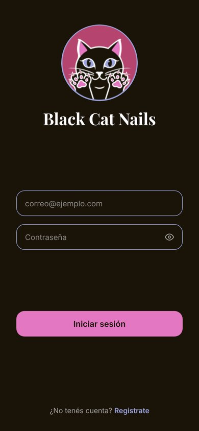 | 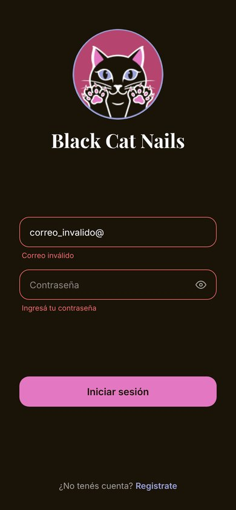 | 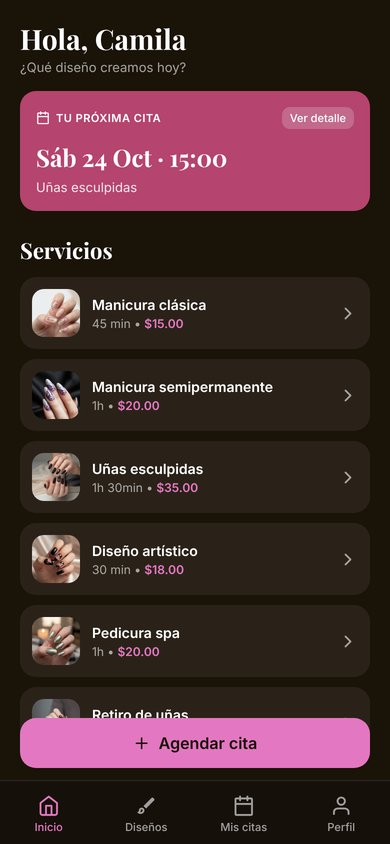 | 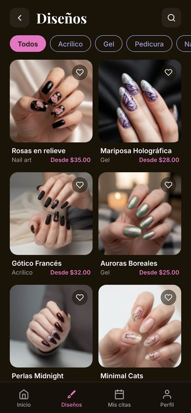 | 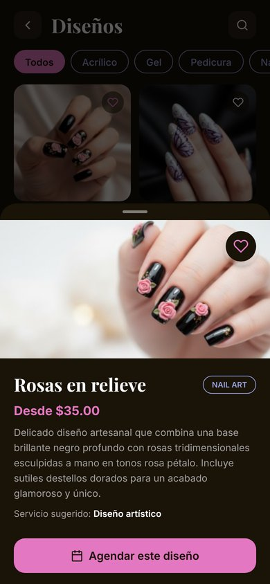 |

| Paso 1 | Paso 2 | Paso 3 | Comprobante | Mis citas |
| --- | --- | --- | --- | --- |
| 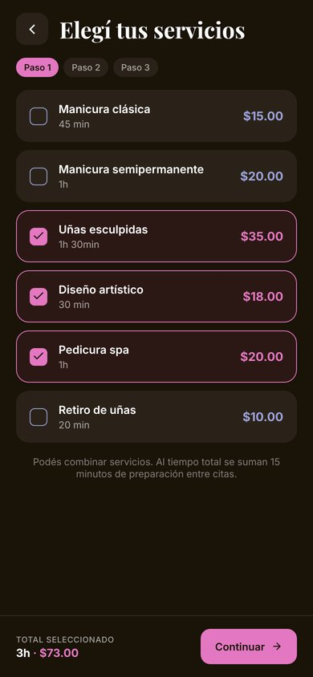 | 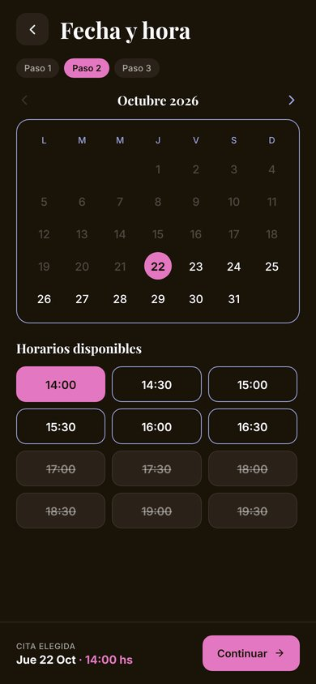 | 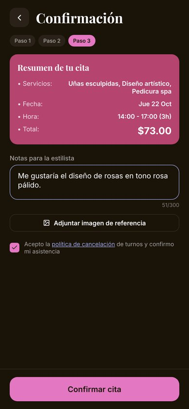 | 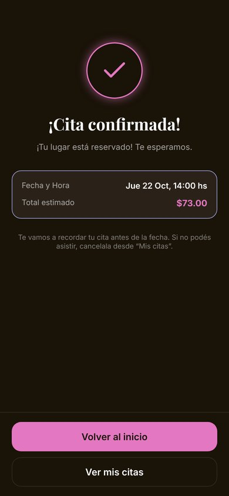 | 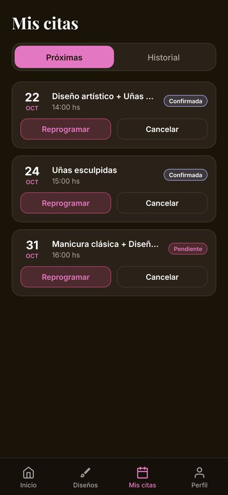 |

| Historial y retoque | Perfil y referidos | Registro | Agenda (admin) | Estado vacío |
| --- | --- | --- | --- | --- |
| 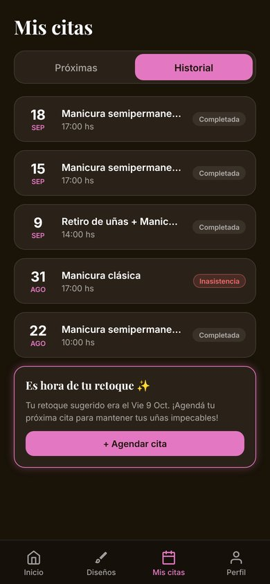 | 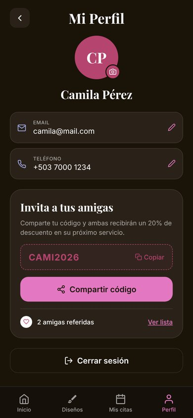 | 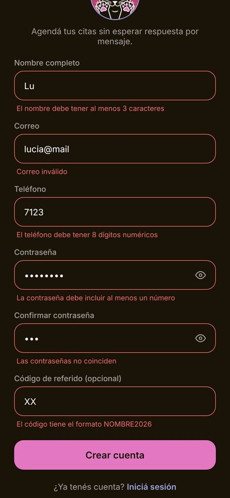 | 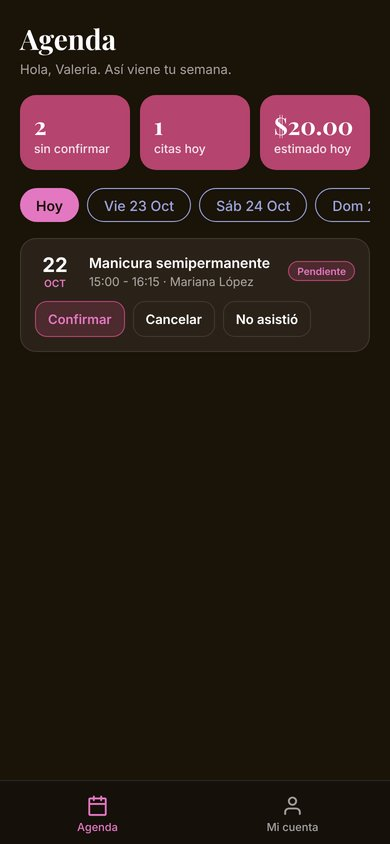 | 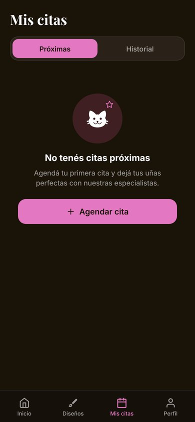 |

## Requerimientos del Avance 1

| Requerimiento | Implementación |
| --- | --- |
| Autenticación (login/registro) | `LoginScreen` y `RegistroScreen`, sesión persistente de 8 horas y cierre de sesión seguro |
| Módulo principal con navegación | Pestañas (Inicio, Diseños, Mis citas, Perfil) y stack de agendamiento en 4 pasos con React Navigation |
| Diseño coherente con Figma | 15 frames del prototipo implementados con los mismos tokens, tipografías y componentes |
| Validaciones de formularios | Esquemas Zod (los mismos de la web) con error por campo, en login, registro, confirmación de cita y perfil |
| Roles diferenciados | Clienta y administradora ven árboles de navegación distintos; la capa de datos vuelve a validar el rol |

## Funcionalidades

- **Agendamiento con cálculo dinámico de duración:** la duración y el monto se recalculan con cada servicio elegido; los horarios que no caben antes del cierre o que se cruzan con otra cita aparecen deshabilitados. Al confirmar, la disponibilidad se vuelve a validar.
- **Control de inasistencias:** confirmación explícita con política de cancelación, cancelación solo hasta 12 horas antes y contador de inasistencias.
- **Retorno programado:** al completar una cita se calcula la fecha de retoque según el ciclo del servicio; la app muestra el aviso cuando se acerca o ya pasó.
- **Galería de diseños:** filtros por categoría, búsqueda, favoritos por usuaria y agendar desde un diseño.
- **Referidos:** código propio por clienta, copiar y compartir, conteo de amigas registradas con el código.
- **Imágenes:** foto de perfil e imagen de referencia adjunta a la cita con `expo-image-picker`.
- **Administradora:** agenda de 7 días con indicadores del día y transiciones de estado (confirmar, iniciar, completar, cancelar, no asistió). Completar una cita descuenta insumos y calcula el retoque.

## Arquitectura

Separación en tres capas, igual que en la web:

```
src/
├── screens/       Presentación: pantallas por rol (auth, clienta, agendar, admin)
├── components/    Presentación: componentes reutilizables del sistema de diseño
├── navigation/    Navegación por rol (React Navigation)
├── context/       Estado global: AuthContext, CatalogoContext, AgendaContext
├── domain/        Lógica de negocio pura (disponibilidad, estados de cita, retoque, referidos)
├── schemas/       Validaciones Zod compartidas con la web
├── services/      Acceso a datos: interfaz estable que en el Foro 2 apunta a Firebase
├── data/          API simulada con persistencia en AsyncStorage y datos semilla
├── config/        Horario del negocio y parámetros (preparación, anticipación de cancelación)
└── theme/         Tokens de Figma
```

- `domain/disponibilidad.ts`, `domain/estadosCita.ts` y `domain/inventario.ts` son los mismos módulos de la versión web: la regla de negocio se escribe una vez.
- Las pantallas solo hablan con los contextos; los contextos solo hablan con `services/`. Cambiar la API simulada por Firestore en el Foro 2 no toca pantallas ni lógica.

## Cómo ejecutar

Requisitos: Node.js 20 o superior y la app **Expo Go** (compatible con SDK 58) en el teléfono.

```bash
git clone https://github.com/Kikeagv/black-cat-nails-mobile.git
cd black-cat-nails-mobile
npm install
npx expo start
```

Escaneá el código QR con Expo Go (Android) o con la cámara (iOS). Para revisar tipos: `npm run typecheck`.

### Cuentas de prueba

| Rol | Correo | Contraseña | Qué muestra |
| --- | --- | --- | --- |
| Clienta | `camila@mail.com` | `Password123` | Próximas citas, historial, referidos |
| Clienta | `sofia@mail.com` | `Password123` | Aviso de retoque vencido |
| Administradora | `vante@blackcatnails.sv` | `Password123` | Agenda y cambios de estado |

Desde la cuenta de la administradora, en **Mi cuenta → Restaurar datos de demostración**, se vuelve al estado inicial.

## Próximo avance (Foro 2)

- Firebase Authentication (correo y Google) en `services/authService.ts`.
- Cloud Firestore en `services/citasService.ts` y `services/catalogoService.ts`, con reglas de seguridad por rol.
- Imágenes en hosting gratuito (Cloudinary o ImgBB).

## Licencia

[CC BY-NC 4.0](LICENSE) · Enrique Alejandro García Villeda, 2026.
