# Black Cat Nails · Solución multiplataforma

Sistema de gestión de citas para el emprendimiento de manicura **Black Cat Nails by Vante**, desarrollado como proyecto de cátedra de **DPS941 (Diseño y Programación de Software Multiplataforma)** en la **Universidad Don Bosco**. Tiene dos clientes que comparten un mismo backend en Firebase:

- **App móvil** (raíz del repositorio): React Native con Expo, para las clientas y la administradora.
- **Versión web** ([`web/`](web)): Next.js 16, con el portal de clientas y el panel administrativo.

Las dos usan **Firebase Authentication** (correo/contraseña y Google) y **Cloud Firestore**: una cuenta creada en el teléfono entra en la web, y una cita agendada en la web aparece al instante en la agenda de la app.

> **Etapa 3 · Entrega final.** Todo el material de la entrega (código web y móvil, documentos de cada etapa, mockups, capturas, reglas de seguridad, scripts y guías) está dentro de este repositorio y se describe en este README.

## Contenido

- [Integrante](#integrante)
- [Entregables](#entregables)
- [Enlaces del proyecto](#enlaces-del-proyecto)
- [Problema que resuelve](#problema-que-resuelve)
- [Requerimientos de la entrega final](#requerimientos-de-la-entrega-final)
- [Arquitectura multiplataforma](#arquitectura-multiplataforma)
- [Mockups de Figma](#mockups-de-figma)
- [Versión web](#versión-web)
- [App móvil](#app-móvil)
- [Cómo ejecutar](#cómo-ejecutar)
- [Pruebas y verificación](#pruebas-y-verificación)
- [Estructura del repositorio](#estructura-del-repositorio)
- [Licencia](#licencia)

## Integrante

| Nombre | Carné | Rama |
| --- | --- | --- |
| Enrique Alejandro García Villeda | GV200136 | `enrique-garcia` |

Docente: Alexander Alberto Siguenza Campos · DPS941 G01T · Facultad de Ingeniería, Universidad Don Bosco. El proyecto es individual: todos los commits del historial (web y móvil) pertenecen al único integrante.

## Entregables

| Etapa | Contenido | Documento |
| --- | --- | --- |
| Etapa 3 · Entrega final | Solución multiplataforma completa: web en `web/` y app móvil en la raíz, con Firebase compartido | Este README |
| Etapa 3 · Avance 2 · Foro 2 | Firebase Authentication, Cloud Firestore, módulos secundarios y reglas de seguridad en la app móvil | [Avance2_BlackCatNails_GV200136.pdf](docs/entregas/Avance2_BlackCatNails_GV200136.pdf) |
| Etapa 3 · Avance 1 · Foro 1 | Diseño UX/UI en Figma y app en React Native | [Avance1_BlackCatNails_GV200136.pdf](docs/entregas/Avance1_BlackCatNails_GV200136.pdf) |
| Etapa 2 | Versión web en Next.js (historial conservado en `web/`) | [web/README.md](web/README.md) |
| Etapa 1 | Análisis, planificación y mockups | [Etapa1_Analisis_BlackCatNails_GV200136.pdf](docs/entregas/Etapa1_Analisis_BlackCatNails_GV200136.pdf) |

## Enlaces del proyecto

| Recurso | Enlace |
| --- | --- |
| Despliegue web (Vercel) | [black-cat-nails.vercel.app](https://black-cat-nails.vercel.app) |
| Prototipo en Figma | [Black Cat Nails · Figma](https://www.figma.com/design/HuzR5fGLVFFeSiOJksZZls/CN?node-id=92-2) (exportado también en [`docs/mockups/`](docs/mockups)) |
| Video del Avance 2 | [youtu.be/A5dQKUByHSs](https://youtu.be/A5dQKUByHSs) |

## Problema que resuelve

La propietaria dedica entre 10 y 14 horas semanales a coordinar citas por mensajería, tiene entre 12 % y 19 % de inasistencias y ya sufrió citas encimadas. La solución traslada el agendamiento a la clienta (en el teléfono o en la web): consulta el catálogo, ve solo los horarios donde cabe el servicio que eligió, confirma su asistencia y recibe el aviso de retoque. La administradora gestiona agenda, clientas, servicios e inventario desde la web o desde la app.

## Requerimientos de la entrega final

| Requerimiento | Cómo se cumple |
| --- | --- |
| 1. Web en React + Next.js desplegada en Vercel | [`web/`](web), Next.js 16 con App Router. Se despliega en Vercel con *Root Directory* `web` ([pasos](web/README.md#despliegue-en-vercel)) |
| 2. Móvil en React Native con Firebase | Raíz del repositorio, Expo SDK 58 con Firebase Authentication y Cloud Firestore |
| 3. Autenticación completa (correo y redes sociales) en ambas plataformas | Correo/contraseña, **Google** y recuperación de contraseña en web ([`web/src/services/authService.ts`](web/src/services/authService.ts)) y móvil ([`src/services/authService.ts`](src/services/authService.ts)). Primer ingreso con Google pide el teléfono en las dos |
| 4. Módulos principales y secundarios | Principales: agendamiento con disponibilidad, mis citas, agenda de la administradora. Secundarios: galería y favoritos, historial de actividad, referidos, foto de perfil, clientas, servicios, inventario, dashboard e indicadores |
| 5. Persistencia en Firestore compartida entre web y móvil | Mismas colecciones y mismo modelo de datos ([ver abajo](#modelo-de-datos-compartido)). La reserva de horario usa `agendaDias/{fecha}` en una transacción desde ambas plataformas |
| 6. Diseño UX/UI coherente con Figma | Misma paleta y tipografías (Playfair Display e Inter) en web y móvil; comparación Figma vs. implementación en [Mockups de Figma](#mockups-de-figma) |
| 7. Mockups publicados en el README | [Mockups de Figma](#mockups-de-figma), imágenes en [`docs/mockups/`](docs/mockups) |
| 8. Licencia Creative Commons | [CC BY-NC 4.0](LICENSE) |
| 9. Repositorio con rama por alumno y README descriptivo | Rama `enrique-garcia`, este README y [`web/README.md`](web/README.md) |

## Arquitectura multiplataforma

```
                ┌──────────────────────────────┐        ┌──────────────────────────────┐
                │  App móvil (React Native)    │        │  Web (Next.js en Vercel)     │
                │  screens → context → services│        │  páginas → context → services│
                │  SDK de Firebase (cliente)   │        │  /api Route Handlers         │
                └──────────────┬───────────────┘        │  firebase-admin (servidor)   │
                               │                        └──────────────┬───────────────┘
                               ▼                                       ▼
              ┌───────────────────────────────────────────────────────────────────────┐
              │                     Firebase (un solo proyecto)                       │
              │  Authentication: correo/contraseña · Google                           │
              │  Cloud Firestore: usuarias · servicios · insumos · citas · agendaDias │
              │  firestore.rules (para los clientes) · 37 pruebas en el emulador      │
              └───────────────────────────────────────────────────────────────────────┘
```

- **Misma identidad.** Las dos plataformas autentican contra el mismo Firebase Authentication. La web verifica el ID token en el servidor y abre una cookie httpOnly; la app guarda la sesión con AsyncStorage.
- **Mismos datos.** La app escribe en Firestore con el SDK de cliente, protegida por [`firestore.rules`](firestore.rules). La web escribe desde sus Route Handlers con `firebase-admin`, protegida por `requireSession`/`requireRol`.
- **Misma lógica de negocio.** `domain/` (disponibilidad, máquina de estados de la cita, consumo de insumos, retoque, referidos) existe en las dos con las mismas reglas: 15 minutos de preparación entre citas, cancelación hasta 12 horas antes, horario del local.
- **Sin choques de horario entre plataformas.** Crear una cita es una transacción que revisa y escribe `agendaDias/{fecha}`. Si una clienta en el teléfono y otra en la web eligen la misma hora, la segunda recibe "Ese horario acaba de ocuparse".

### Modelo de datos compartido

```
usuarias/{uid}                 perfil, rol, inasistencias, código de referido, proveedor (password/google)
  ├─ favoritos/{disenoId}      diseños guardados (móvil)
  └─ actividad/{id}            historial: registro, inicios de sesión, citas y cambios de estado (web y móvil)
codigosReferido/{codigo}       índice de códigos únicos → uid
referidos/{uid}                quién se registró con qué código
servicios/{id}                 catálogo (la administradora lo edita en la web)
insumos/{id}                   inventario (web y móvil)
citas/{id}                     clientaId, servicios congelados, inicio/fin, estado, fecha, inicioMs
agendaDias/{YYYY-MM-DD}        bloques ocupados del día, sin datos personales
```

## Mockups de Figma

Prototipo completo: [Figma](https://www.figma.com/design/HuzR5fGLVFFeSiOJksZZls/CN?node-id=92-2). Las imágenes están en [`docs/mockups/`](docs/mockups).

**Web (panel de la administradora)**

| Dashboard | Agenda semanal |
| --- | --- |
|  |  |

| Clientas | Inventario |
| --- | --- |
|  |  |

**Móvil (frame de Figma a la izquierda, app a la derecha)**

| Login | Error de validación | Inicio | Galería | Fecha y hora |
| --- | --- | --- | --- | --- |
|  |  |  |  |  |

| Confirmación | Comprobante | Mis citas | Perfil y referidos | Estado vacío |
| --- | --- | --- | --- | --- |
|  |  |  |  |  |

Las dos plataformas usan la paleta del prototipo (fondo oscuro, Berry Crush, Petal Pink y Wisteria Blue) y las mismas tipografías, Playfair Display e Inter: en móvil desde [`src/theme/tokens.ts`](src/theme/tokens.ts) y en web desde las variables de [`web/src/app/globals.css`](web/src/app/globals.css).

## Versión web

Detalle completo en [`web/README.md`](web/README.md).

| Login (correo y Google) | Registro | Inicio de la clienta | Agendar |
| --- | --- | --- | --- |
|  |  |  |  |

| Mis citas | Dashboard | Agenda (incluye citas creadas en la app) | Clientas |
| --- | --- | --- | --- |
|  |  |  |  |

| Inventario | Servicios |
| --- | --- |
|  |  |

- **Clienta:** catálogo con filtros, agendamiento en tres pasos con disponibilidad en vivo, próximas citas e historial, cancelación con 12 horas de anticipación.
- **Administradora:** dashboard con indicadores e ingresos, agenda semanal con cambios de estado y citas manuales, servicios, inventario con alertas de reposición, directorio de clientas con historial y notas privadas.
- **Datos:** todo se lee y escribe en el Firestore compartido; ya no hay base en memoria ni `seed.json`.

## App móvil

### Requerimientos del Avance 1 (app móvil)

| Requerimiento | Implementación |
| --- | --- |
| Autenticación (login/registro) | `LoginScreen` y `RegistroScreen`, sesión persistente de 8 horas y cierre de sesión seguro |
| Módulo principal con navegación | Pestañas (Inicio, Diseños, Mis citas, Perfil) y stack de agendamiento en 4 pasos con React Navigation |
| Diseño coherente con Figma | 15 frames del prototipo implementados con los mismos tokens, tipografías y componentes |
| Validaciones de formularios | Esquemas Zod (los mismos de la web) con error por campo, en login, registro, confirmación de cita y perfil |
| Roles diferenciados | Clienta y administradora ven árboles de navegación distintos; la capa de datos vuelve a validar el rol |

### Funcionalidades de la app móvil

- **Agendamiento con cálculo dinámico de duración:** la duración y el monto se recalculan con cada servicio elegido; los horarios que no caben antes del cierre o que se cruzan con otra cita aparecen deshabilitados. Al confirmar, la disponibilidad se vuelve a validar.
- **Control de inasistencias:** confirmación explícita con política de cancelación, cancelación solo hasta 12 horas antes y contador de inasistencias.
- **Retorno programado:** al completar una cita se calcula la fecha de retoque según el ciclo del servicio; la app muestra el aviso cuando se acerca o ya pasó.
- **Galería de diseños:** filtros por categoría, búsqueda, favoritos por usuaria y agendar desde un diseño.
- **Referidos:** código propio por clienta, copiar y compartir, conteo de amigas registradas con el código.
- **Imágenes:** foto de perfil e imagen de referencia adjunta a la cita con `expo-image-picker`.
- **Administradora:** agenda de 7 días con indicadores del día y transiciones de estado (confirmar, iniciar, completar, cancelar, no asistió). Completar una cita descuenta insumos y calcula el retoque.


| Login | Error | Inicio | Galería | Detalle |
| --- | --- | --- | --- | --- |
| 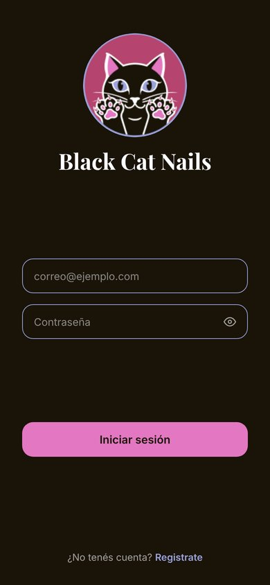 | 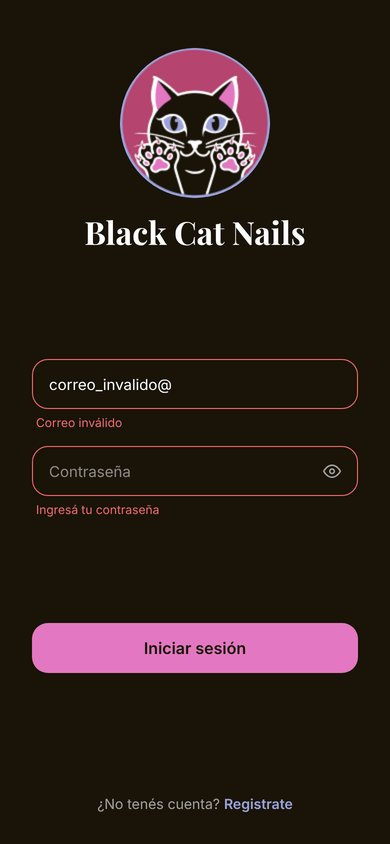 | 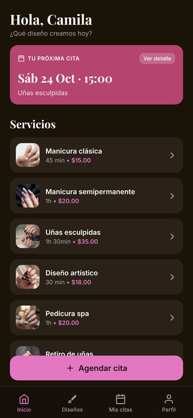 | 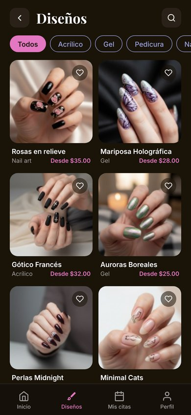 | 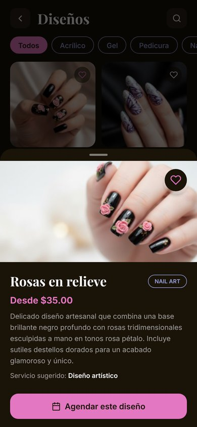 |

| Paso 1 | Paso 2 | Paso 3 | Comprobante | Mis citas |
| --- | --- | --- | --- | --- |
| 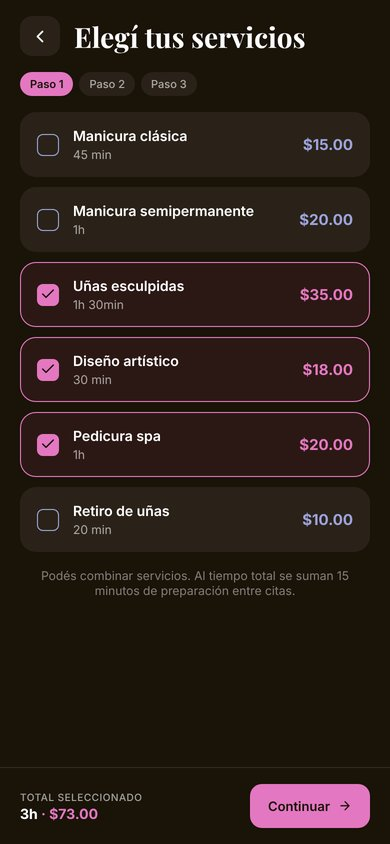 | 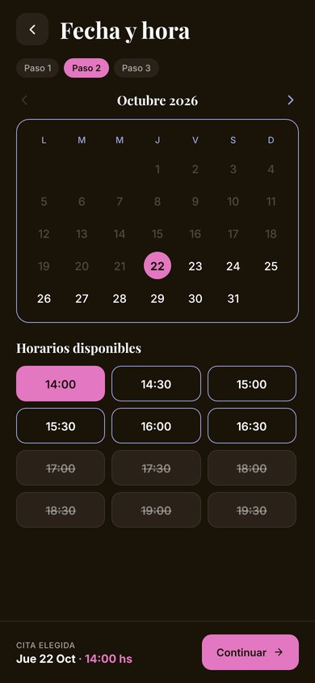 | 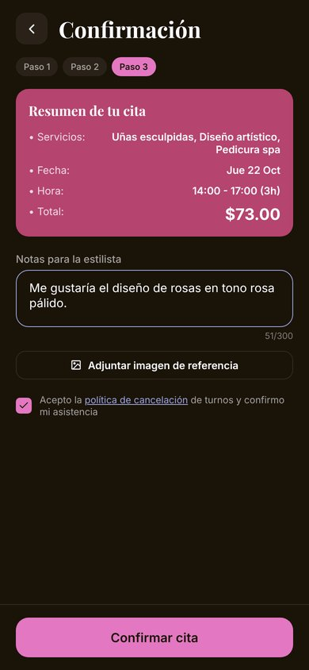 | 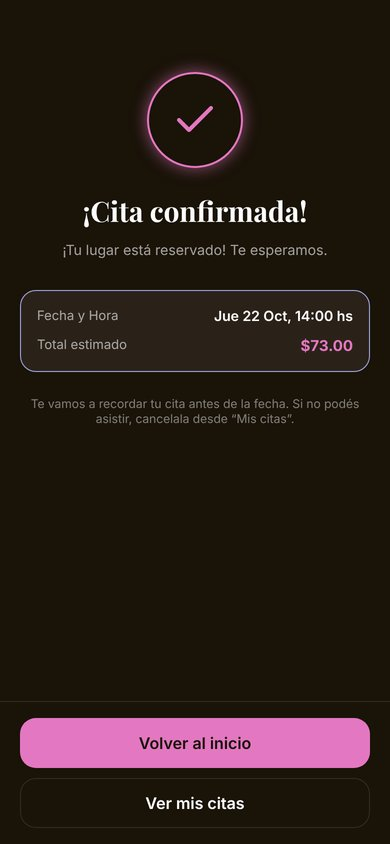 | 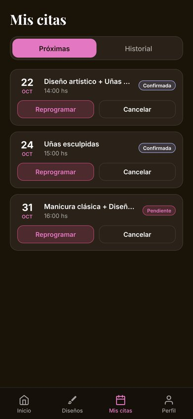 |

| Historial y retoque | Perfil y referidos | Registro | Agenda (admin) | Estado vacío |
| --- | --- | --- | --- | --- |
| 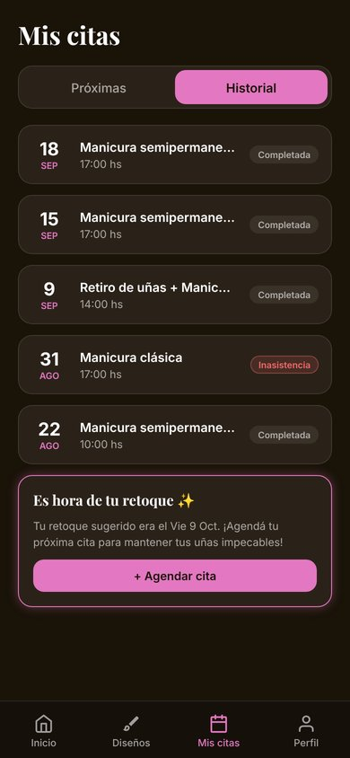 | 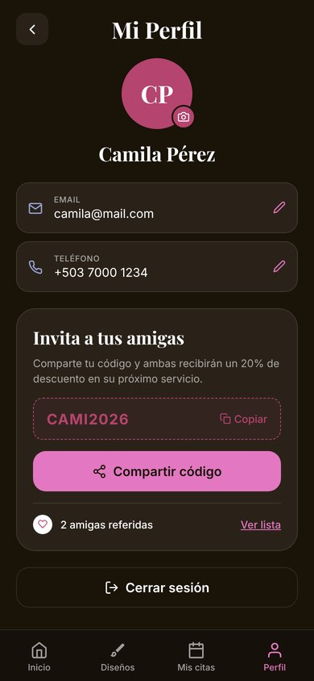 | 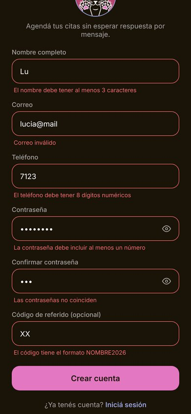 | 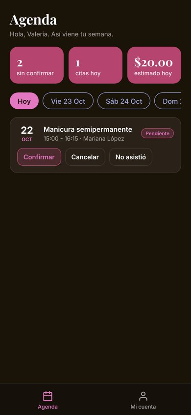 | 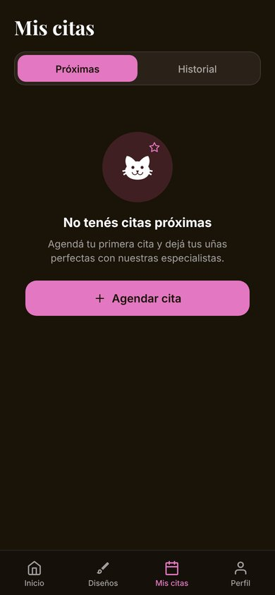 |

### Firebase en la app móvil (Avance 2)

| Requerimiento del Foro 2 | Implementación |
| --- | --- |
| Autenticación con Firebase (correo y Google) | `services/authService.ts`: correo/contraseña, Google (ventana emergente en web, SDK nativo en iOS/Android), recuperación de contraseña, sesión persistente con AsyncStorage y pantalla para completar el perfil en el primer ingreso con Google |
| Persistencia en Firestore asociada a la usuaria | Perfil en `usuarias/{uid}`, citas con `clientaId = uid`, favoritos e historial como subcolecciones de la usuaria |
| Módulos secundarios | Historial de actividad, favoritos en la nube, referidos, foto de perfil e inventario de la administradora |
| Historial o visualización de registros | **Mi actividad** (`usuarias/{uid}/actividad`, en tiempo real, con filtros) e historial de citas en **Mis citas** |
| Reglas de seguridad | [`firestore.rules`](firestore.rules), probadas con 37 casos en el emulador (`npm run test:reglas`) |

| Error de Firebase | Disponibilidad | Cita guardada | Mis citas | Historial |
| --- | --- | --- | --- | --- |
| 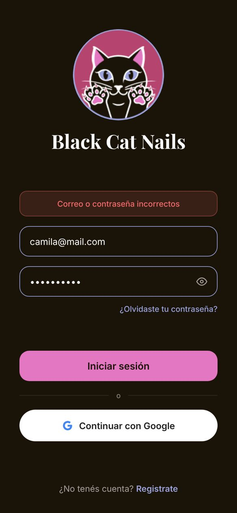 | 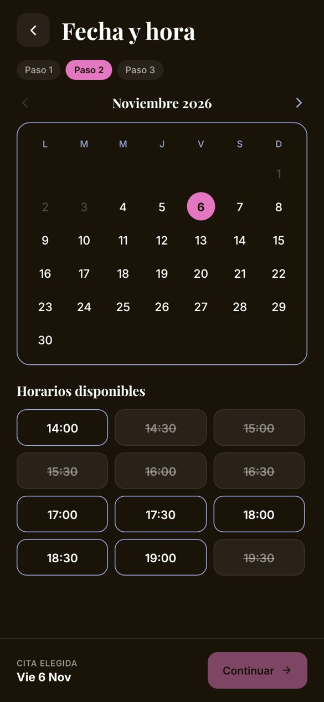 | 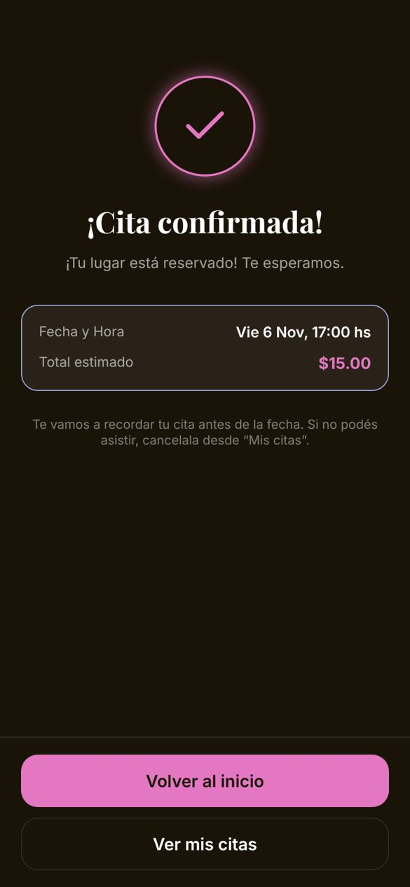 | 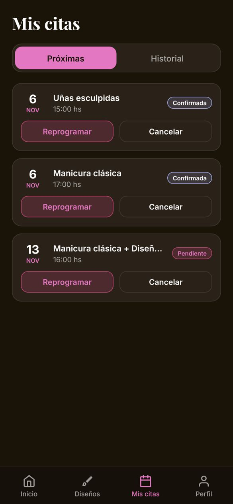 | 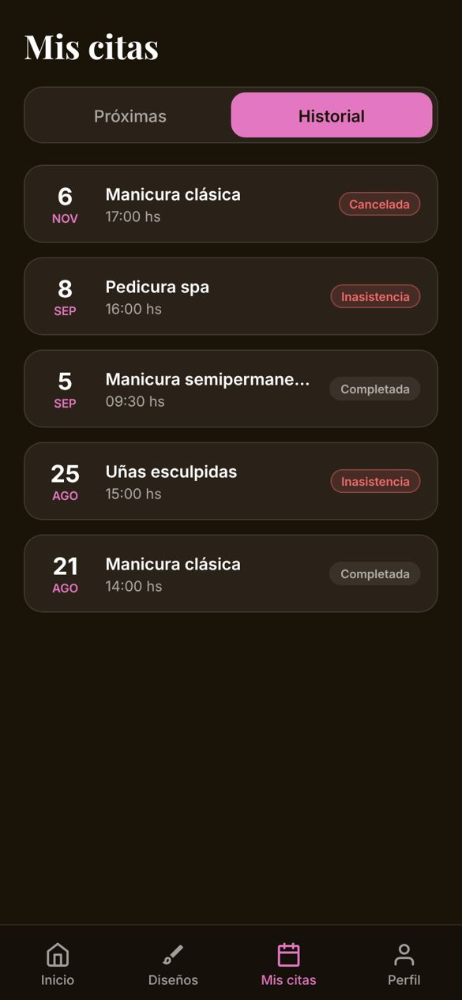 |

| Mi actividad | Perfil y referidas | Google: completar perfil | Agenda (admin) | Inventario (admin) |
| --- | --- | --- | --- | --- |
| 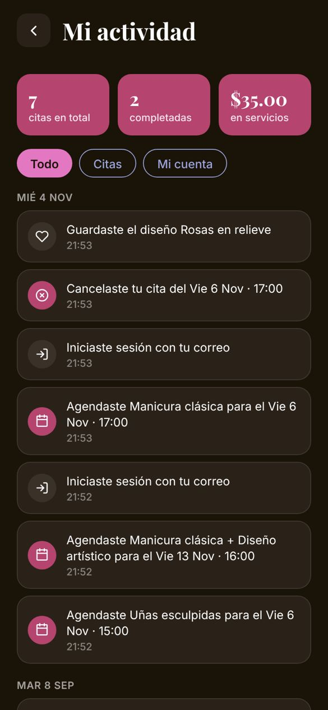 | 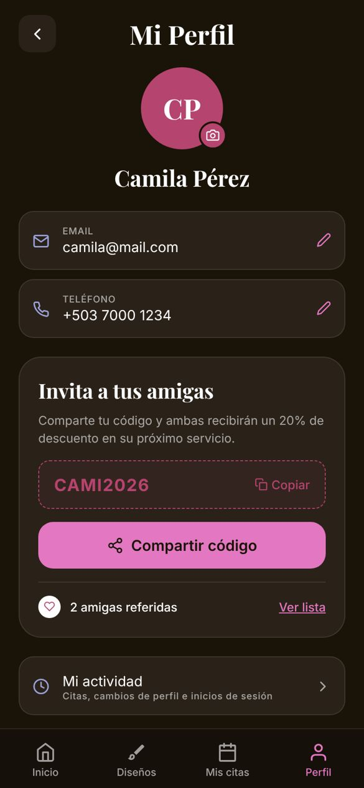 | 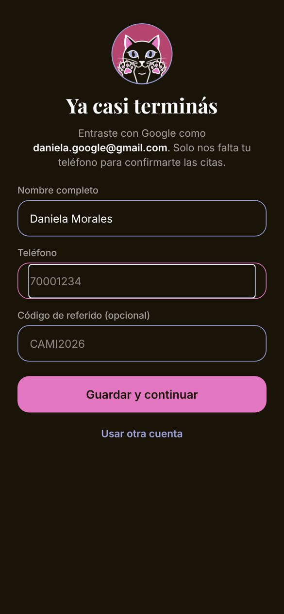 | 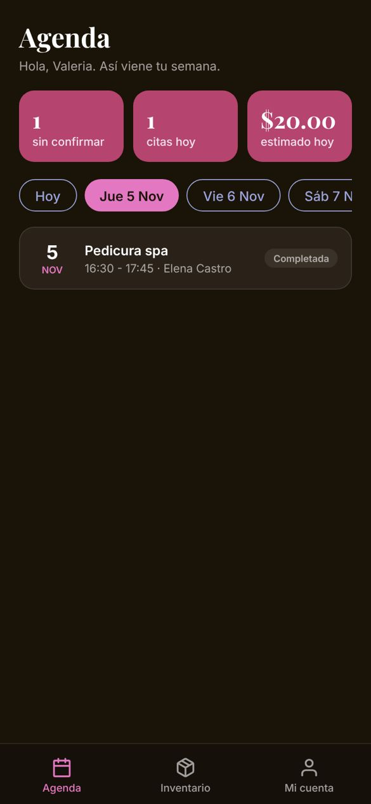 | 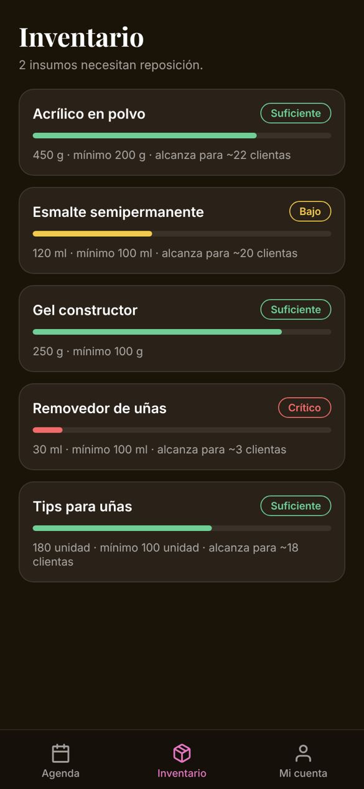 |

#### Cómo usa Firestore la app

- **Sin choques de horario:** crear una cita es una transacción que lee `agendaDias/{fecha}`, vuelve a calcular la disponibilidad con `domain/disponibilidad.ts` y escribe la cita y su bloque juntos. Si dos clientas eligen la misma hora, la segunda recibe "Ese horario acaba de ocuparse".
- **Completar una cita** también es una transacción: cambia el estado, descuenta insumos, calcula el retoque y, si es inasistencia, suma el contador de la clienta.
- **Tiempo real:** citas, perfil, favoritos, historial e inventario usan `onSnapshot`. Si la administradora confirma una cita, la clienta lo ve sin recargar.
- **Imágenes:** Cloud Storage pide el plan Blaze, así que la foto de perfil (320 px) y la imagen de referencia (600 px) se reducen con `expo-image-manipulator` y se guardan en base64 dentro del documento.

### Arquitectura de la app móvil

```
src/
├── screens/       Presentación: pantallas por rol (auth, clienta, agendar, admin)
├── components/    Presentación: componentes reutilizables del sistema de diseño
├── navigation/    Navegación según el estado de la sesión y el rol (React Navigation)
├── context/       Estado global: AuthContext, CatalogoContext, AgendaContext
├── domain/        Lógica de negocio pura, la misma de la web (disponibilidad, estados, retoque)
├── schemas/       Validaciones Zod compartidas con la web
├── services/      Acceso a datos: Firebase Auth y Cloud Firestore
│   └── firebase/  Inicialización, referencias de colecciones y Google Sign-In por plataforma
├── config/        Horario del negocio y variables de Firebase
└── theme/         Tokens de Figma
firestore.rules    Reglas de seguridad
scripts/           Carga de datos de demostración y pruebas de reglas
```

Las pantallas solo hablan con los contextos y los contextos solo hablan con `services/`. Pasar de la API simulada del Foro 1 a Firebase no cambió la lógica de negocio ni el diseño de las pantallas.

## Cómo ejecutar

Requisitos: Node.js 20 o superior y un proyecto de Firebase con Authentication (correo y Google) y Firestore activados. La guía paso a paso está en [`docs/configuracion-firebase.md`](docs/configuracion-firebase.md).

### 1. Firebase y datos (una sola vez, desde la raíz)

```bash
git clone https://github.com/Kikeagv/black-cat-nails-mobile.git
cd black-cat-nails-mobile
npm install
cp .env.example .env          # valores de la app web registrada en Firebase
npx firebase-tools login
npm run reglas:deploy -- --project <id-del-proyecto>
npm run seed                  # necesita scripts/serviceAccount.json (en .gitignore)
```

### 2. App móvil

```bash
npx expo start                # Expo Go; Google en iOS: npx expo run:ios
```

### 3. Versión web

```bash
cd web
npm install
cp .env.example .env.local    # mismos valores de Firebase + SESSION_SECRET + cuenta de servicio
npm run dev                   # http://localhost:3000
```

Despliegue en Vercel: *Root Directory* `web` y las variables de `web/.env.example` ([pasos](web/README.md#despliegue-en-vercel)).

### Sin conexión a la nube: emuladores

```bash
npm run emuladores            # Auth + Firestore + interfaz en http://127.0.0.1:4000 (necesita Java)
npm run seed:emuladores       # en otra terminal
EXPO_PUBLIC_USAR_EMULADORES=1 npx expo start
# web: descomentar el bloque de emuladores de web/.env.example en web/.env.local y npm run dev
```

### Cuentas de prueba

Las mismas cuentas funcionan en la web y en la app.

| Rol | Correo | Contraseña | Qué muestra |
| --- | --- | --- | --- |
| Clienta | `camila@mail.com` | `Password123` | Próximas citas, historial, actividad, 2 referidas |
| Clienta | `sofia@mail.com` | `Password123` | Aviso de retoque vencido |
| Administradora | `vante@blackcatnails.sv` | `Password123` | Agenda, cambios de estado e inventario |

`npm run seed -- --reset` vuelve al estado inicial antes de grabar una demo.

## Pruebas y verificación

| Comando | Qué verifica |
| --- | --- |
| `npm run typecheck` (raíz) | TypeScript de la app móvil sin errores |
| `npm run test:reglas` (raíz, con el emulador) | 37 casos de las reglas de seguridad de Firestore, incluidos accesos que deben rechazarse |
| `cd web && npx tsc --noEmit && npm run lint && npm run build` | Tipos, lint y build de producción de la web |

Prueba integrada web + móvil contra los emuladores (22 de noviembre de 2026):

| Caso | Resultado |
| --- | --- |
| Iniciar sesión en la web con una cuenta creada por el seed de la app | Entra con su perfil de `usuarias/{uid}` |
| La clienta agenda en la web | La cita y su bloque en `agendaDias` se crean en una transacción |
| Agendar dos veces el mismo horario | La segunda recibe `409 horario_ocupado` |
| La administradora cancela en la web | El bloque del día se libera para la app |
| Registro con correo en la web | Cuenta en Authentication y perfil con código de referido, igual que en móvil |
| Primer ingreso con Google en la web | Pide teléfono; el perfil queda con `proveedor: google` |
| La agenda web muestra citas creadas desde la app | Sí, se leen del mismo Firestore |

## Estructura del repositorio

| Ruta | Qué contiene |
| --- | --- |
| [`src/`](src) | App móvil (React Native + Expo) |
| [`web/`](web) | Versión web (Next.js), con su propio [README](web/README.md) |
| [`firestore.rules`](firestore.rules) | Reglas de seguridad de Firestore compartidas |
| [`scripts/`](scripts) | Carga de datos de demostración y pruebas de las reglas |
| [`docs/entregas/`](docs/entregas) | Documentos en PDF de la Etapa 1, Avance 1 y Avance 2 |
| [`docs/mockups/`](docs/mockups) | Mockups de Figma (web y móvil) |
| [`docs/capturas/`](docs/capturas) | Capturas de la app móvil (`/`, `foro2/`) y de la web (`web/`) |
| [`docs/configuracion-firebase.md`](docs/configuracion-firebase.md) | Guía paso a paso de Firebase, incluido Google Sign-In en iOS |
| [`.env.example`](.env.example), [`web/.env.example`](web/.env.example) | Variables de entorno sin valores reales |
| [`LICENSE`](LICENSE) | Licencia Creative Commons BY-NC 4.0 |

## Licencia

[CC BY-NC 4.0](LICENSE) · Enrique Alejandro García Villeda, 2026. Aplica a todo el repositorio (web y móvil).
