# Black Cat Nails · App móvil

Aplicación móvil en **React Native (Expo)** para el emprendimiento de manicura **Black Cat Nails by Vante**. Es la versión para clientas del sistema multiplataforma desarrollado en **DPS941 (Diseño y Programación de Software Multiplataforma)** de la **Universidad Don Bosco**. La versión web administrativa vive en [Kikeagv/Black-cat-nails-web](https://github.com/Kikeagv/Black-cat-nails-web).

> Entregas: **Etapa 3 · Avance 1 · Foro 1** (Diseño UX/UI + React Native) y **Etapa 3 · Avance 2 · Foro 2** (Firebase + módulos).

## Integrante

| Nombre | Carné | Rama |
| --- | --- | --- |
| Enrique Alejandro García Villeda | GV200136 | `enrique-garcia` |

## Problema que resuelve

La propietaria dedica entre 10 y 14 horas semanales a coordinar citas por mensajería, tiene entre 12 % y 19 % de inasistencias y ya sufrió citas encimadas. La app traslada el agendamiento a la clienta: consulta el catálogo y la galería, ve solo los horarios donde cabe el servicio que eligió, confirma su asistencia y recibe el aviso de retoque cuando le toca volver.

## Diseño

- Prototipo en Figma: [Black Cat Nails · Mobile](https://www.figma.com/design/HuzR5fGLVFFeSiOJksZZls/CN?node-id=92-2)
- Los tokens de Figma (`Dark #191308`, `Berry Crush #B5446E`, `Petal Pink #E477C1`, `Wisteria Blue #9CA3DB`) están en [`src/theme/tokens.ts`](src/theme/tokens.ts). Tipografías: Playfair Display (títulos) e Inter (texto).

| Login | Error | Inicio | Galería | Detalle |
| --- | --- | --- | --- | --- |
| 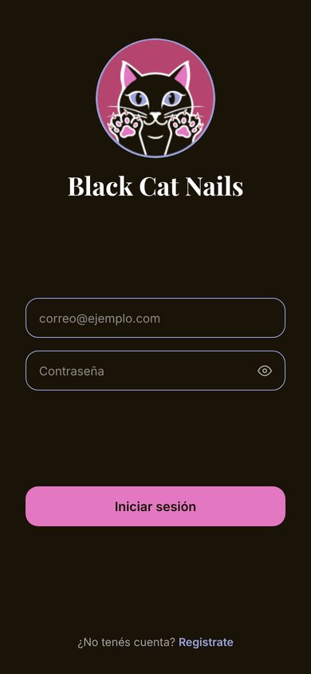 | 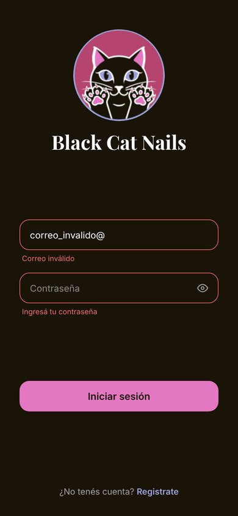 | 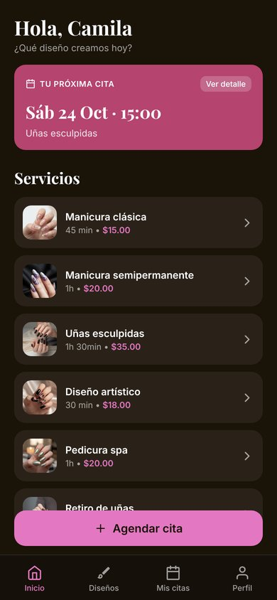 | 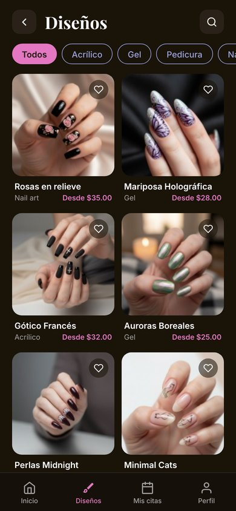 | 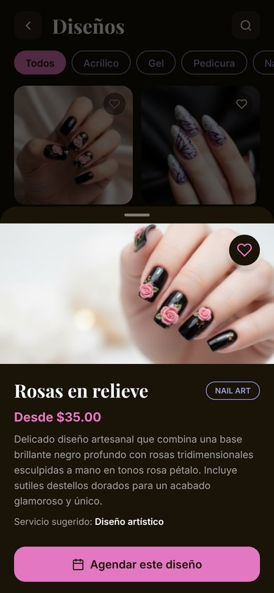 |

| Paso 1 | Paso 2 | Paso 3 | Comprobante | Mis citas |
| --- | --- | --- | --- | --- |
| 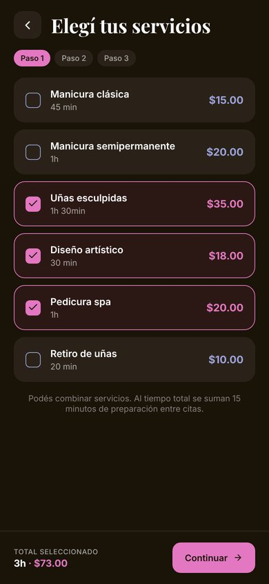 | 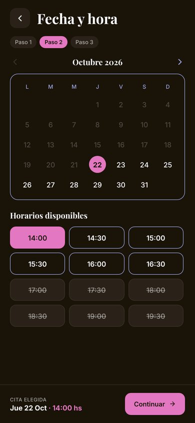 | 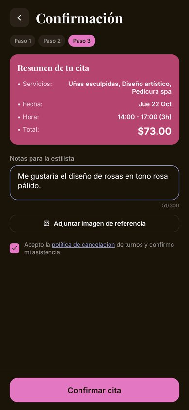 | 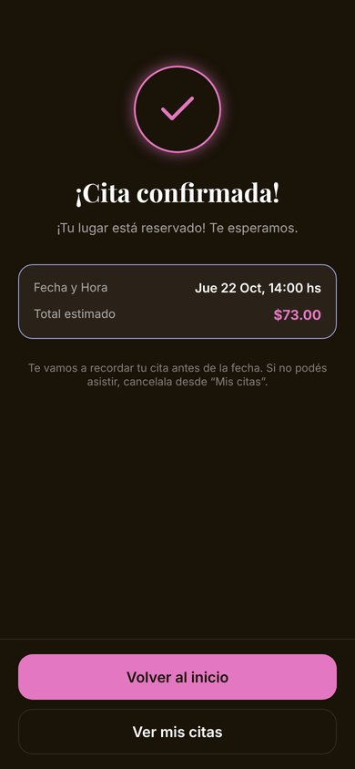 | 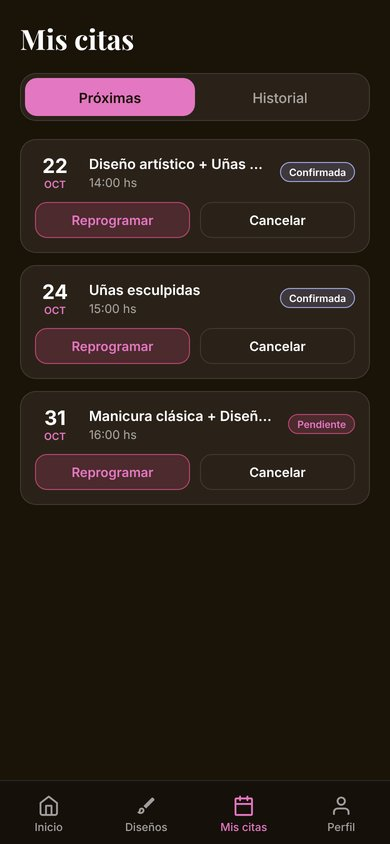 |

| Historial y retoque | Perfil y referidos | Registro | Agenda (admin) | Estado vacío |
| --- | --- | --- | --- | --- |
| 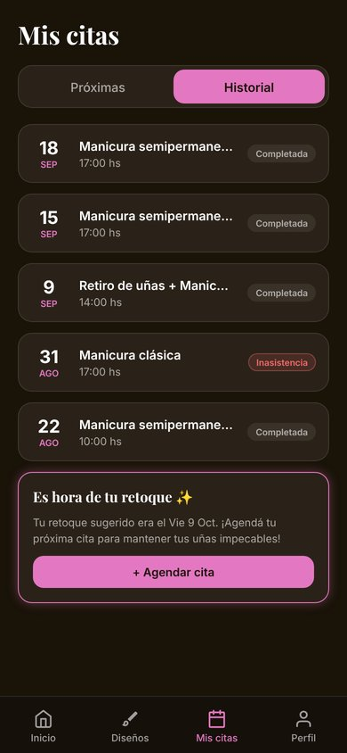 | 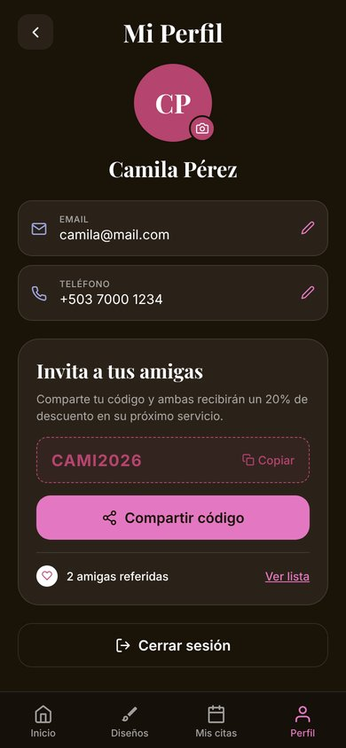 | 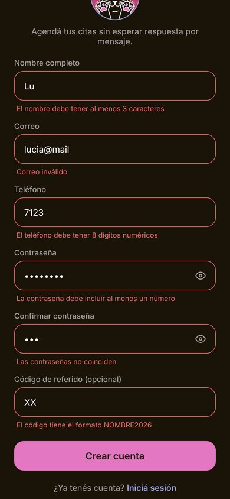 | 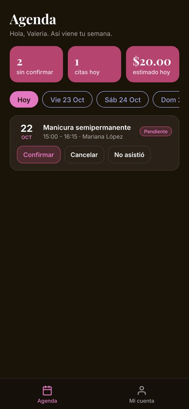 | 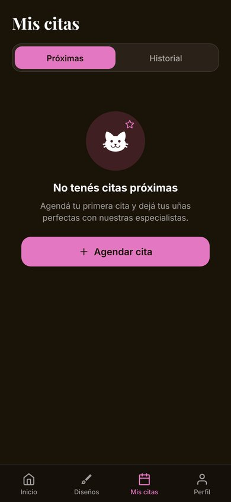 |

## Requerimientos del Avance 1

| Requerimiento | Implementación |
| --- | --- |
| Autenticación (login/registro) | `LoginScreen` y `RegistroScreen`, sesión persistente de 8 horas y cierre de sesión seguro |
| Módulo principal con navegación | Pestañas (Inicio, Diseños, Mis citas, Perfil) y stack de agendamiento en 4 pasos con React Navigation |
| Diseño coherente con Figma | 15 frames del prototipo implementados con los mismos tokens, tipografías y componentes |
| Validaciones de formularios | Esquemas Zod (los mismos de la web) con error por campo, en login, registro, confirmación de cita y perfil |
| Roles diferenciados | Clienta y administradora ven árboles de navegación distintos; la capa de datos vuelve a validar el rol |

## Funcionalidades

- **Agendamiento con cálculo dinámico de duración:** la duración y el monto se recalculan con cada servicio elegido; los horarios que no caben antes del cierre o que se cruzan con otra cita aparecen deshabilitados. Al confirmar, la disponibilidad se vuelve a validar.
- **Control de inasistencias:** confirmación explícita con política de cancelación, cancelación solo hasta 12 horas antes y contador de inasistencias.
- **Retorno programado:** al completar una cita se calcula la fecha de retoque según el ciclo del servicio; la app muestra el aviso cuando se acerca o ya pasó.
- **Galería de diseños:** filtros por categoría, búsqueda, favoritos por usuaria y agendar desde un diseño.
- **Referidos:** código propio por clienta, copiar y compartir, conteo de amigas registradas con el código.
- **Imágenes:** foto de perfil e imagen de referencia adjunta a la cita con `expo-image-picker`.
- **Administradora:** agenda de 7 días con indicadores del día y transiciones de estado (confirmar, iniciar, completar, cancelar, no asistió). Completar una cita descuenta insumos y calcula el retoque.

## Avance 2: Firebase

| Requerimiento del Foro 2 | Implementación |
| --- | --- |
| Autenticación con Firebase (correo y Google) | `services/authService.ts`: correo/contraseña, Google (ventana emergente en web, SDK nativo en iOS/Android), recuperación de contraseña, sesión persistente con AsyncStorage y pantalla para completar el perfil en el primer ingreso con Google |
| Persistencia en Firestore asociada a la usuaria | Perfil en `usuarias/{uid}`, citas con `clientaId = uid`, favoritos e historial como subcolecciones de la usuaria |
| Módulos secundarios | Historial de actividad, favoritos en la nube, referidos, foto de perfil e inventario de la administradora |
| Historial o visualización de registros | **Mi actividad** (`usuarias/{uid}/actividad`, en tiempo real, con filtros) e historial de citas en **Mis citas** |
| Reglas de seguridad | [`firestore.rules`](firestore.rules), probadas con 37 casos en el emulador (`npm run test:reglas`) |

| Error de Firebase | Disponibilidad | Cita guardada | Mis citas | Historial |
| --- | --- | --- | --- | --- |
| 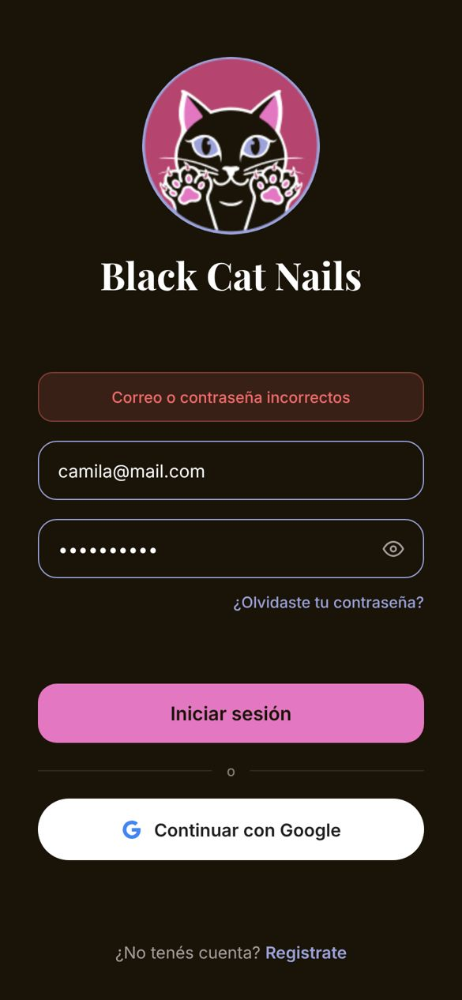 | 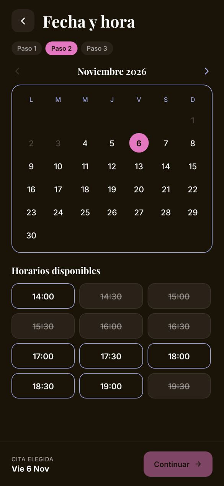 | 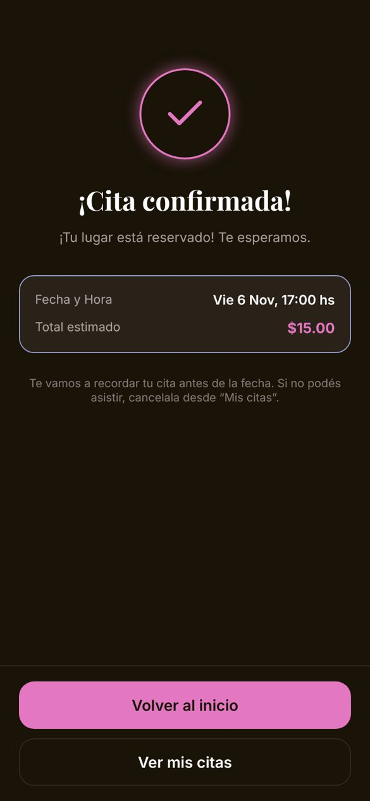 | 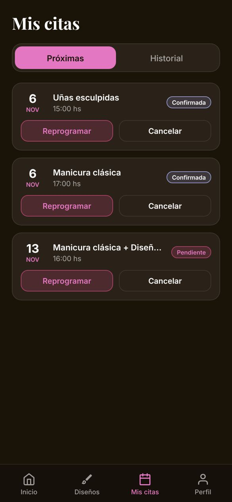 | 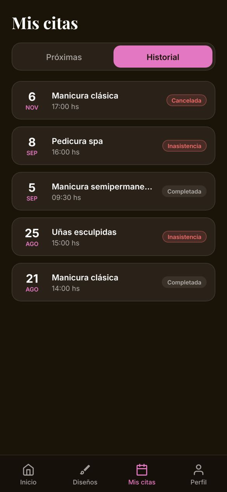 |

| Mi actividad | Perfil y referidas | Google: completar perfil | Agenda (admin) | Inventario (admin) |
| --- | --- | --- | --- | --- |
| 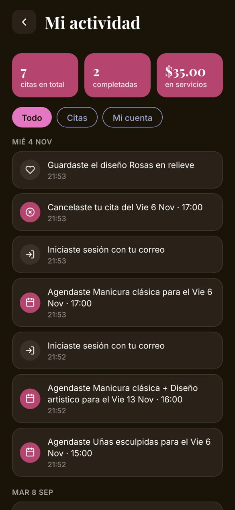 | 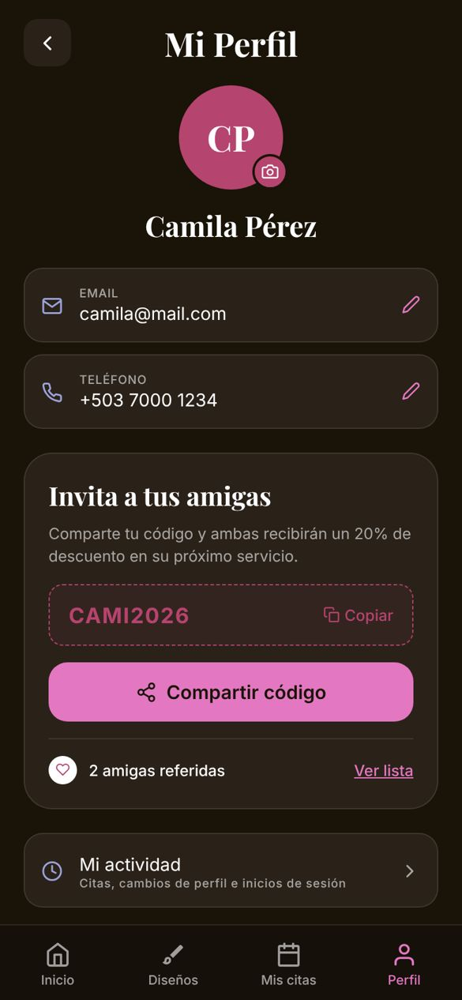 | 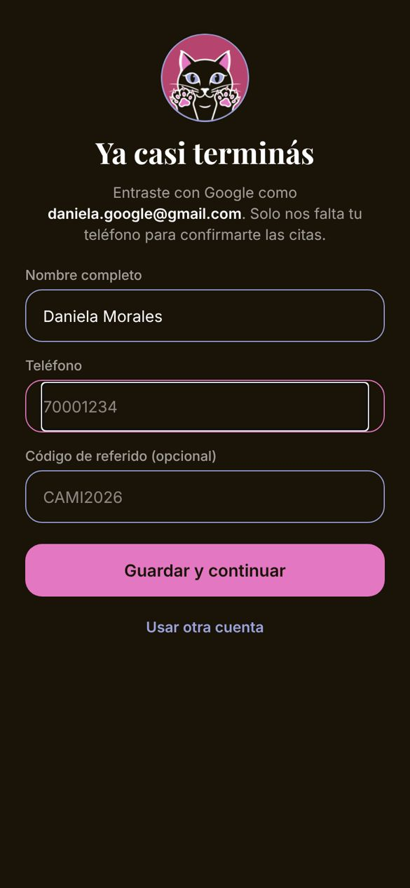 | 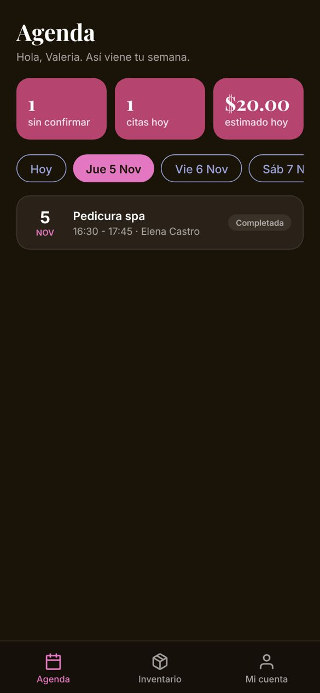 | 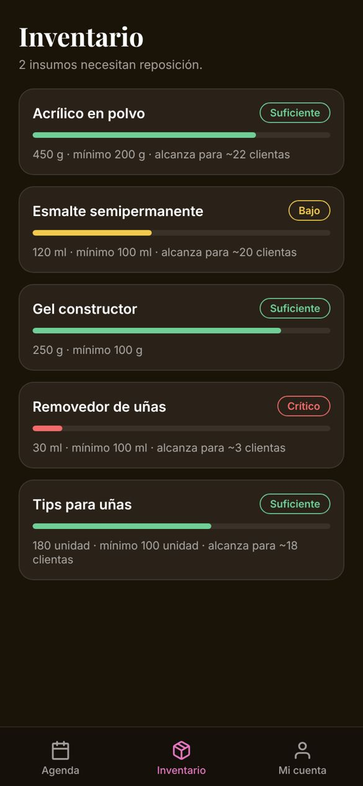 |

### Modelo de datos en Firestore

```
usuarias/{uid}                 perfil, rol, inasistencias, código de referido, foto (miniatura)
  ├─ favoritos/{disenoId}      diseños guardados
  └─ actividad/{id}            historial inmutable (tipo, descripción, fecha del servidor)
codigosReferido/{codigo}       índice de códigos únicos → uid
referidos/{uid}                quién se registró con qué código (solo nombre)
servicios/{id}                 catálogo; solo la administradora escribe
insumos/{id}                   inventario; solo la administradora lee y escribe
citas/{id}                     clientaId, servicios congelados, inicio/fin, estado, inicioMs
agendaDias/{YYYY-MM-DD}        bloques ocupados del día (inicio, fin, uid), sin datos personales
```

- **Sin choques de horario:** crear una cita es una transacción que lee `agendaDias/{fecha}`, vuelve a calcular la disponibilidad con `domain/disponibilidad.ts` y escribe la cita y su bloque juntos. Si dos clientas eligen la misma hora, la segunda recibe "Ese horario acaba de ocuparse".
- **Completar una cita** también es una transacción: cambia el estado, descuenta insumos, calcula el retoque y, si es inasistencia, suma el contador de la clienta.
- **Tiempo real:** citas, perfil, favoritos, historial e inventario usan `onSnapshot`. Si la administradora confirma una cita, la clienta lo ve sin recargar.
- **Imágenes:** Cloud Storage pide el plan Blaze, así que la foto de perfil (320 px) y la imagen de referencia (600 px) se reducen con `expo-image-manipulator` y se guardan en base64 dentro del documento.

## Arquitectura

```
src/
├── screens/       Presentación: pantallas por rol (auth, clienta, agendar, admin)
├── components/    Presentación: componentes reutilizables del sistema de diseño
├── navigation/    Navegación según el estado de la sesión y el rol (React Navigation)
├── context/       Estado global: AuthContext, CatalogoContext, AgendaContext
├── domain/        Lógica de negocio pura, la misma de la web (disponibilidad, estados, retoque)
├── schemas/       Validaciones Zod compartidas con la web
├── services/      Acceso a datos: Firebase Auth y Cloud Firestore
│   └── firebase/  Inicialización, referencias de colecciones y Google Sign-In por plataforma
├── config/        Horario del negocio y variables de Firebase
└── theme/         Tokens de Figma
firestore.rules    Reglas de seguridad
scripts/           Carga de datos de demostración y pruebas de reglas
```

Las pantallas solo hablan con los contextos y los contextos solo hablan con `services/`. Pasar de la API simulada del Foro 1 a Firebase no cambió la lógica de negocio ni el diseño de las pantallas.

## Cómo ejecutar

Requisitos: Node.js 20 o superior y un proyecto de Firebase con Authentication (correo y Google) y Firestore activados.

```bash
git clone https://github.com/Kikeagv/black-cat-nails-mobile.git
cd black-cat-nails-mobile
npm install
cp .env.example .env          # completar con los datos de la app web de Firebase
```

1. **Reglas:** `npx firebase-tools login` y después `npm run reglas:deploy -- --project <id-del-proyecto>` (o pegá `firestore.rules` en la consola, en Firestore → Reglas).
2. **Datos de demostración:** en la consola, Configuración del proyecto → Cuentas de servicio → Generar nueva clave privada. Guardala como `scripts/serviceAccount.json` (está en `.gitignore`) y corré `npm run seed`.
3. **App:** `npx expo start`. Con Expo Go funciona todo menos Google; para Google en iOS compilá la app con `npx expo run:ios` (necesita Xcode). En la versión web (`w` en la terminal de Expo) Google funciona con la ventana emergente.

### Sin conexión a la nube: emuladores

```bash
npm run emuladores            # Auth + Firestore + interfaz en http://127.0.0.1:4000 (necesita Java)
npm run seed:emuladores       # en otra terminal
EXPO_PUBLIC_USAR_EMULADORES=1 npx expo start
npm run test:reglas           # 37 pruebas de las reglas de seguridad
```

### Cuentas de prueba

| Rol | Correo | Contraseña | Qué muestra |
| --- | --- | --- | --- |
| Clienta | `camila@mail.com` | `Password123` | Próximas citas, historial, actividad, 2 referidas |
| Clienta | `sofia@mail.com` | `Password123` | Aviso de retoque vencido |
| Administradora | `vante@blackcatnails.sv` | `Password123` | Agenda, cambios de estado e inventario |

`npm run seed -- --reset` vuelve al estado inicial antes de grabar una demo.

## Licencia

[CC BY-NC 4.0](LICENSE) · Enrique Alejandro García Villeda, 2026.
